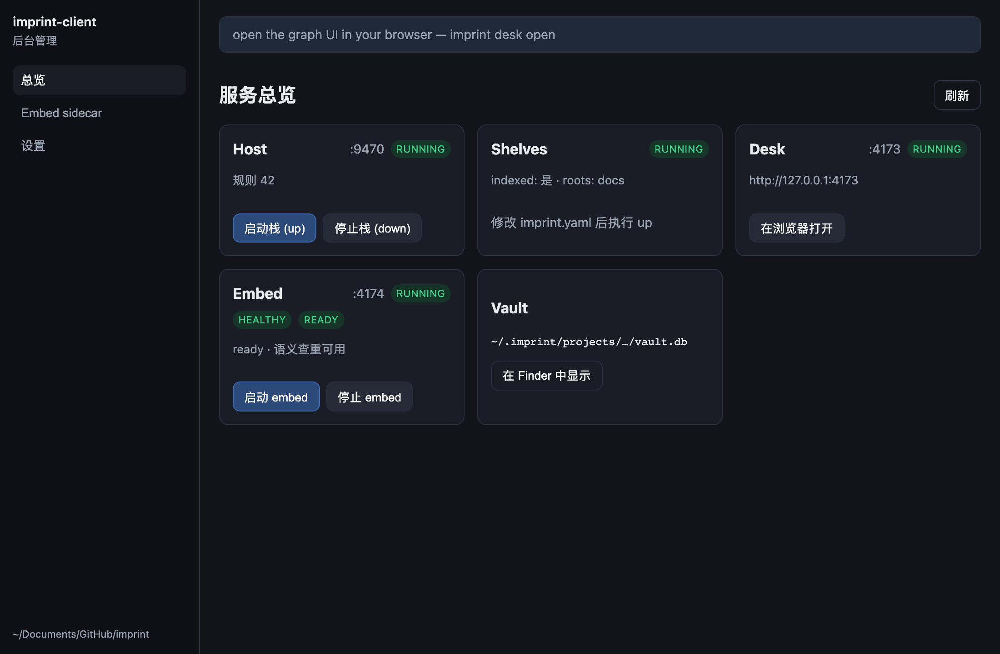
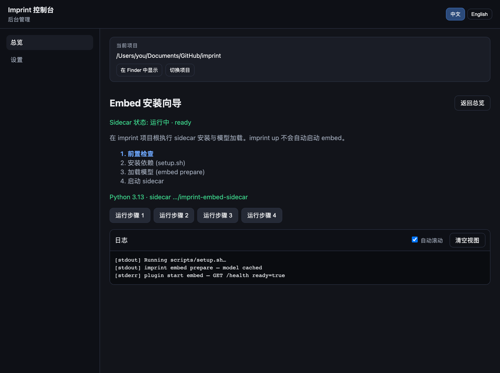
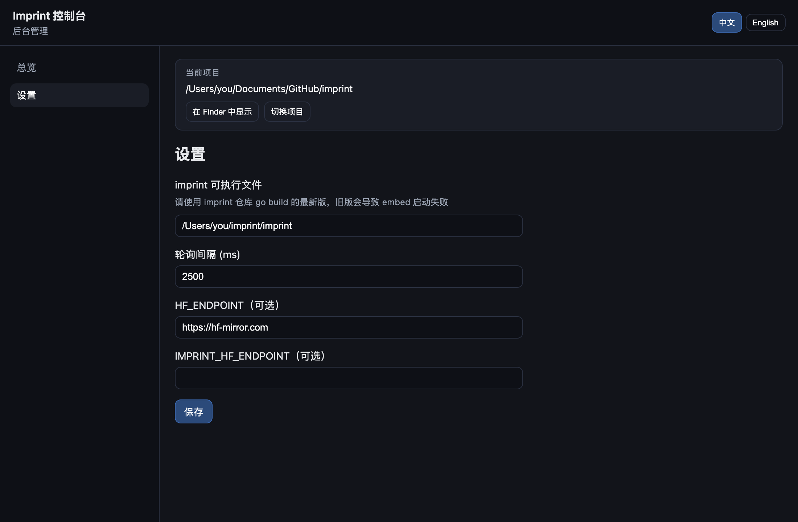

<div align="center">


# Imprint Console

**imprint 后台运维控制台**

[](https://github.com/SteamedBread2333/imprint-console/releases)


查看 Host / Shelves / Desk、全局 Embed；可自动安装 imprint / Python / sidecar。  
不是终端用户产品；审计规则请用 [imprint-desk-plugin](https://github.com/SteamedBread2333/imprint-desk-plugin)。

</div>

## 开始

需要 Rust、Node 20+、**git**（clone sidecar）、联网（首次准备运行环境）。

```bash
git clone https://github.com/SteamedBread2333/imprint-client.git
cd imprint-client
npm install --legacy-peer-deps
npm run tauri dev
```

首次启动在弹窗中 **准备运行环境**；也可在 **设置 → 运行环境** 中安装或更新。  
Embed 配置全局一份：`~/.imprint/embed.yaml`（项目 `imprint.yaml` **不含** `plugins.embed`）。  
可选：选择含 `imprint.yaml` 的项目根以管理 Host / Shelves / Desk；不选项目也可启停 Embed。

详见 [docs/runtime-releases.md](docs/runtime-releases.md)。

## 截图

| 总览 | Embed 向导 | 设置 |
|:---:|:---:|:---:|
|  |  |  |

更新 UI 后：`npm run screenshots`

## 下载哪个包？

在 [Releases](https://github.com/SteamedBread2333/imprint-client/releases) 按系统选 **一个** 即可（文件名里的 `0.1.0` 随版本变化）。

| 文件 | 适用 |
| --- | --- |
| `*_aarch64.dmg` | **macOS · Apple 芯片**（M1 / M2 / M3 / M4） |
| `*_x64.dmg` | **macOS · Intel** |
| `*_aarch64.app.tar.gz` | macOS Apple 芯片，解压得到 `.app`（免 DMG 安装器） |
| `*_x64.app.tar.gz` | macOS Intel，同上 |
| `*_amd64.deb` | **Debian / Ubuntu** 等（`sudo dpkg -i …deb`） |
| `*-1.x86_64.rpm` | **Fedora / RHEL** 等 RPM 系 |
| `*_amd64.AppImage` | 通用 **Linux x86_64**，chmod +x 后直接运行 |
| `*.msi` / `*-setup.exe` | **Windows 10/11** x64（以 Release 实际文件名为准） |

说明：

- **Release 仅含桌面控制台**。**imprint CLI** 使用 **go install 全局路径**（如 `~/go/bin/imprint`）；**Python 与 embed sidecar** 在应用数据目录。详见 [runtime-releases](docs/runtime-releases.md)（需 Go 与网络）。
- **Linux** 构建目标为 **x86_64（amd64）**，不提供 arm64 Linux 包。
- **macOS CI 产物为 ad-hoc 签名、未公证**。签名会封住 `.app` 里的资源和 `Info.plist`；未封住时 Gatekeeper 会把安装包判成「已损坏」。首次打开仍可能要在「系统设置 → 隐私与安全性」里允许。

## 常见问题

**Embed `health check failed`** — 更新运行环境中的 imprint，再 **embed prepare** → **plugin start embed**（全局配置，无需项目 cwd）。

配置目录（macOS）：`~/Library/Application Support/com.imprint.client/config.json`

## License

MIT
